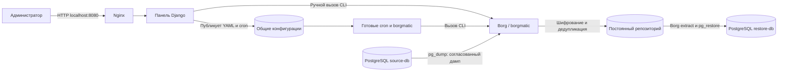

# Архитектура первого стенда

Блок Borg/borgmatic обозначает готовые утилиты, доступные в двух контейнерах, а не шестой сетевой сервис. Расписание выполняется в контейнере scheduler, ручные операции — из панели. Обе стороны используют один репозиторий и один файл блокировки задания.

PostgreSQL client и серверы используют основную версию 15. Исходная БД не копируется как каталог живых файлов: borgmatic использует встроенный PostgreSQL hook и pg_dump. При восстановлении тот же инструмент вызывает pg_restore на другом сервере.

Панель хранит пользователей, задания и журнал ручных операций в SQLite на отдельном томе. Журналы cron — текстовый вывод готовых утилит. Во внешнюю сеть опубликован только Nginx на loopback-интерфейсе хоста.

Для первого стенда принят один фиксированный источник и один фиксированный тестовый приёмник; адреса серверов не принимаются из HTTP-запроса. Секреты передаются через окружение, в YAML остаются ссылки на переменные. Идентификаторы архивов проверяются до передачи в CLI. Все операции изменения требуют POST и CSRF-токен.

Проверка архива подтверждает целостность репозитория. Отдельная проверка восстановления сравнивает демонстрационные записи в исходной и восстановленной БД. Это разные проверки, обе нужны для демонстрации.
