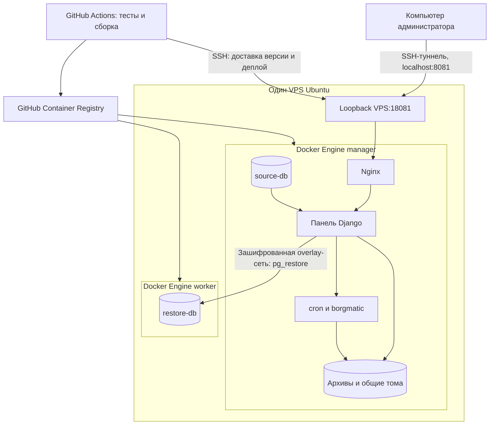

# Кластер и облачное развёртывание

## Принятый учебный вариант

Один уже имеющийся VPS, два контейнера с отдельными Docker Engine: `manager` и `worker`. Это два настоящих узла Swarm с разными идентификаторами, но они используют один физический хост и одно ядро ОС. Отказ VPS остановит оба узла. Схема демонстрирует оркестрацию, а не отказоустойчивость физических серверов.

Выбран Docker Swarm; отдельное внедрение Kubernetes для той же демонстрации не требуется. Минимальный кластер из двух объектов допускает раздел о главе 3 временных методических указаний. Учебный Docker-in-Docker использует privileged-контейнеры; их API доступны только через loopback VPS и приватную сеть стенда. Это лабораторная схема, не изоляция уровня отдельных виртуальных машин.



На manager закреплены panel, scheduler, source-db и proxy (`backup.data=true`). На worker закреплён restore-db (`backup.restore=true`). Все сервисы имеют одну реплику. SQLite панели, конфигурации, блокировки и репозиторий разделяют тома одного узла. Перенос метки на пустой узел не переносит данные: автоматическую миграцию и восстановление хранилища эта схема не реализует.

## Файлы

- `stack.yaml`: пять сервисов, overlay-сеть, Docker configs/secrets, метки размещения и перезапуск.
- `deploy/lab/compose.yaml`: два отдельных Docker Engine с постоянными томами и ограничением памяти.
- `deploy/lab/stack.override.yaml`: публикация Nginx внутри вложенного manager; внешний Docker публикует его только на `127.0.0.1:18081`.
- `scripts/init_swarm_lab.py`: запуск Engine, init/join, метки узлов.
- `scripts/swarm_secrets.py`: однократная загрузка серверных секретов без вывода значений.
- `scripts/deploy_swarm.py`: проверка двух узлов, deploy, ожидание сходимости и настоящее копирование/восстановление через overlay.
- `.github/workflows/ci.yml`: тесты → публикация образов с тегом SHA коммита → доставка версии по SSH → deploy → интеграционная проверка.

## Первоначальная подготовка VPS

Нужны Docker Engine, Compose и Python 3.12, SSH-доступ и свободное место на диске. На малом VPS перед запуском проверяют доступную RAM и swap. В текущем окружении: 1 ГБ RAM, 1 vCPU; добавлен отдельный swap-файл `/swapfile-coursework` размером 2 ГБ с записью в `/etc/fstab`. Существующие приложения не входят в стек курсовой.

Команды выполняются на VPS из каталога загруженной версии проекта:

```bash
python3 scripts/init_swarm_lab.py
# Только один раз: отдельные облачные пароли, не пароли локального стенда.
python3 scripts/prepare_env.py --output /root/coursework-backup/.env.cloud
export DOCKER_HOST=tcp://127.0.0.1:23750
python3 scripts/swarm_secrets.py /root/coursework-backup/.env.cloud
```

Если файл секретов уже существует, генератор откажется его перезаписывать. Имеющиеся Docker secrets сохраняются без замены: редактирование env-файла не является ротацией паролей существующих БД.

После публикации образов:

```bash
export PANEL_IMAGE=ghcr.io/xueaaaa/backup-platform-coursework-panel:COMMIT_SHA
export ENGINE_IMAGE=ghcr.io/xueaaaa/backup-platform-coursework-engine:COMMIT_SHA
export CONFIG_VERSION=COMMIT_SHA
python3 scripts/deploy_swarm.py --lab
```

При приватных образах перед deploy нужен `docker login ghcr.io` с правом чтения пакетов. Workflow передаёт авторизацию через stdin и использует `--with-registry-auth` для узлов. Долговременный доступ после истечения токена Actions отдельно не обеспечивается; для повторного скачивания приватных образов понадобится действующая авторизация.

## Настройки GitHub

Репозиторий: <https://github.com/xueaaaa/backup-platform-coursework>.

Environment: `coursework-cloud`. Secrets: `VPS_HOST`, `VPS_USER`, `VPS_PORT`, `VPS_SSH_KEY`, `VPS_KNOWN_HOSTS`. Ключ CI должен быть разрешён на VPS. Секреты приложения остаются в Docker secrets на VPS, не передаются в исходниках и не печатаются в workflow.

Repository variable `DEPLOY_ENABLED=true` включают после подготовки узлов и Docker secrets. Изменения ветки `main` запускают весь pipeline; pull request выполняет тесты. Ошибка интеграционной проверки делает deploy job неуспешным. Swarm может откатить неудачный старт задачи, но успешная миграция БД автоматически не откатывается; полноценный откат данных отдельно не реализован.

## Открыть облачную панель

На своём компьютере:

```powershell
ssh -i "$env:USERPROFILE/.ssh/coursework_backup_ed25519" -N -L 8081:127.0.0.1:18081 root@АДРЕС_VPS
```

Оставьте окно открытым и перейдите на <http://localhost:8081>. Логин `admin`, пароль — облачный `ADMIN_PASSWORD` из `/root/coursework-backup/.env.cloud`, который отличается от локального. Публичный HTTP-доступ и домен для этой демонстрации не нужны.

На текущем компьютере отдельная копия облачных учётных данных сохранена в локальном `.env.cloud` (исключён из Git и контекста Docker). Для повторного открытия туннеля можно выполнить из корня проекта:

```powershell
powershell -ExecutionPolicy Bypass -File .\docs\connect-cloud.ps1 -Server АДРЕС_VPS
```

## Доказательства для отчёта

На VPS, где задан `DOCKER_HOST=tcp://127.0.0.1:23750`:

```bash
docker node ls
docker stack services coursework-backup-cloud
docker stack ps coursework-backup-cloud
docker network inspect coursework-backup-cloud_backup-net
```

Сохранить два Ready/Active узла, пять сервисов 1/1, размещение restore-db на worker, успешный workflow и `PASS` восстановления. Схема сама по себе и наличие YAML не доказывают выполненный deploy. Фактическое состояние отражается в `VERIFICATION.md`.

## Управление стендом

Команды внешнего Docker выполняются без переменной DOCKER_HOST:

```bash
unset DOCKER_HOST
docker compose -f deploy/lab/compose.yaml stop
docker compose -f deploy/lab/compose.yaml start
```

Остановка лаборатории сохраняет данные её узлов. Тома `manager-data` и `worker-data` содержат в том числе вложенные БД и архивы — удалять их нельзя. Swap-файл оставлен включённым, чтобы после перезагрузки ограниченный по памяти VPS мог запускать лабораторию.

## Документация

- [Развёртывание стека Swarm](https://docs.docker.com/engine/swarm/stack-deploy/).
- [Размещение сервисов и локальные тома](https://docs.docker.com/engine/swarm/services/).
- [Docker secrets](https://docs.docker.com/engine/swarm/secrets/).
- [Публикация образов через GitHub Actions](https://docs.github.com/en/actions/tutorials/publish-packages/publish-docker-images).
